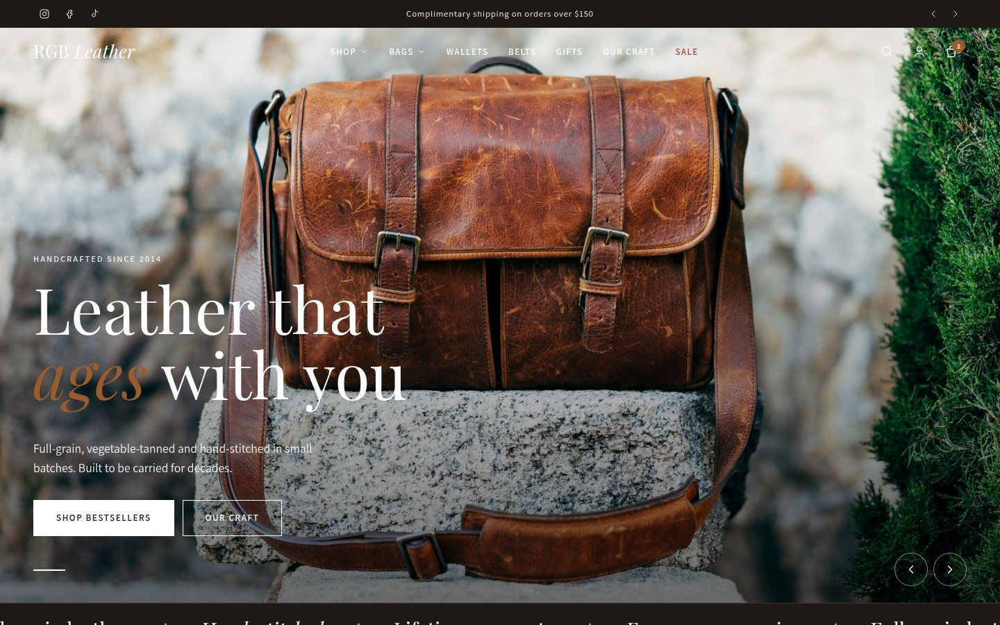
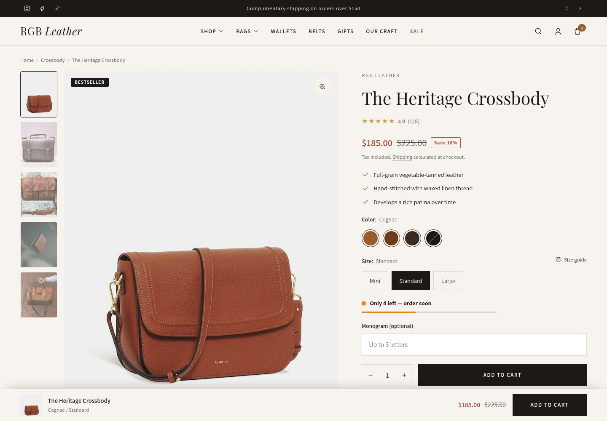
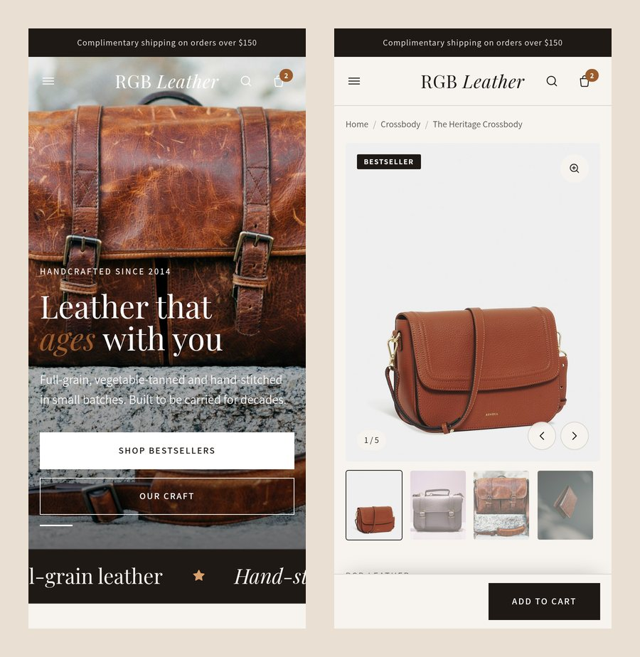
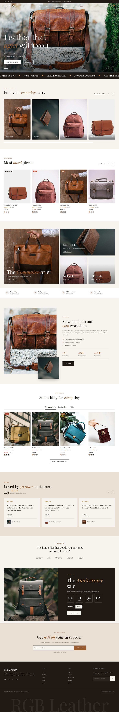

# RGB Leather — Premium Shopify Theme

A modern, conversion-focused **Online Store 2.0** theme built for RGB Leather's handcrafted leather goods. Every page is made of sections, there are no external JavaScript libraries, and it ships with the features you'd expect from a paid premium theme: mega menu, predictive search, cart drawer with a free-shipping bar and upsells, quick add, AJAX filtering, swatches, a sticky add-to-cart bar, urgency and delivery messaging, and more.



> Screenshots are a design preview rendered from the theme's own CSS, JavaScript and section markup with the default settings. Product photos are demo images from [Unsplash](https://unsplash.com) and are **not** part of the theme. Replace them with your own in the theme editor.

---

## Screenshots

| Product page | Mobile |
| --- | --- |
|  |  |

<details>
<summary><strong>Full homepage (click to expand)</strong></summary>



</details>

---

## Highlights

- **Online Store 2.0:** JSON templates, header and footer section groups, app blocks, and sections on every page
- **No dependencies:** about 1,250 lines of vanilla JavaScript web components and one stylesheet (no jQuery, no frameworks)
- **Fast:** responsive `srcset` images, lazy loading, deferred video/3D, the Section Rendering API for every dynamic update, and preloaded fonts
- **Accessible:** semantic HTML, focus traps in drawers and modals, keyboard-navigable menus, tabs, gallery and search, ARIA states, and `prefers-reduced-motion` support
- **SEO:** Product, Article, Organization and FAQPage structured data, Open Graph/Twitter cards, and canonical URLs
- **Lint-clean:** `shopify theme check` reports **0 offenses across 100 files**

## Design system

The look is warm and editorial, suited to leather goods: a cream and espresso palette with cognac accents, an elegant serif for headings (with *italic accent words*), and a clean sans-serif for body text.

| Setting group | What you can control |
| --- | --- |
| **Color schemes** | 5 editable schemes (Cream, White, Espresso, Cognac, Sand), assignable per section |
| **Typography** | Heading/body fonts, size scales, letter spacing, uppercase headings or labels |
| **Layout** | Page width, grid gap, image/card corner radius |
| **Buttons & inputs** | Radius and an animated fill hover effect |
| **Product cards** | Image ratio, crop/fit, hover image, vendor, rating, swatches, quick add, alignment |
| **Badges** | Sale style (text / % / amount), auto "New" badge, custom badges via the `badge:Bestseller` tag |
| **Cart** | Drawer or page, free-shipping threshold, upsells, order notes, terms checkbox, trust message |
| **Animations** | Scroll-reveal and image zoom on hover |

## Sections

### Homepage and anywhere

| Section | Purpose |
| --- | --- |
| **Hero slideshow** | Full-bleed image/video slides, mobile-specific images, Ken Burns motion, progress bars, swipe |
| **Image banner** | Single hero with optional background video |
| **Scrolling text** | Infinite marquee with icon separators |
| **Trust badges** | Shipping, returns, warranty and handmade icons (swipeable on mobile) |
| **Collection list** | Carousel or grid; overlay, below-image or circle tiles |
| **Featured collection** | Product carousel or grid |
| **Collection tabs** | Tabbed product grids (e.g. New / Bestsellers / Gifts) |
| **Promo grid (bento)** | Mixed-size large, wide, tall and small promo tiles |
| **Image with text** | Overlapping detail image, checklist, stat counters, buttons |
| **Multicolumn** | Icons, images or numbered steps, optionally as cards |
| **Testimonials** | Overall score, star ratings, verified badges, linked products |
| **Shop the look** | Lifestyle image with hotspots, product cards and quick add |
| **Video** | Shopify-hosted, YouTube or Vimeo; lazy-loaded behind a poster |
| **Logo list / press** | "As featured in" logos plus a press quote |
| **Countdown promo** | Live timer, copyable discount code, auto-hide when expired |
| **FAQ** | Accordion with Google FAQ rich results |
| **Social gallery** | UGC/Instagram-style image grid |
| **Featured product** | Full buy box (variants, quantity, dynamic checkout) on any page |
| **Blog posts, Rich text, Newsletter, Recently viewed, Custom Liquid** | Supporting sections |

### Product page

The **Product information** section has 19 reorderable blocks plus app blocks:

vendor · title · rating · price (with savings %) · SKU · description · highlights · **variant picker** (color swatches + pills/dropdowns, size-guide popup) · **buy buttons** (quantity, dynamic checkout, installments, optional monogram and gift wrap) · **low-stock urgency bar** · **delivery estimate** (with a same-day dispatch countdown) · trust icons · payment icons · collapsible tabs · **complementary products** · share · text note · divider · custom Liquid · `@app`

Also included:

- **Gallery:** thumbnails on the left or bottom, or a two-column grid; swipe on mobile; counter and arrows; full-screen **zoom lightbox**; video and 3D models
- **Variant switching:** uses the Section Rendering API with `option_values`, supports **combined listings** and updates the URL
- **Sticky add-to-cart bar:** appears after the main button scrolls away
- **Related products** carousel, plus **recently viewed** products saved in the browser

### Collection and search

- Collection banner with breadcrumbs and quick-link pills
- **AJAX storefront filtering:** sticky sidebar on desktop, drawer on mobile; color swatch filters, price range, active-filter pills, browser back/forward support
- Sorting, a 2/3/4 column grid toggle, and **load more**, **infinite scroll** or numbered pagination
- Promo tiles inserted into the product grid
- Product cards: hover image, sale/new/custom badges, ratings, color swatches that preview the variant image, **quick add / quick view**

### Cart

- **Cart drawer:** free-shipping progress bar, quantity controls, recommendation upsells, gift note, terms checkbox, trust message
- Cart page with a sticky summary and accelerated checkout buttons

### Also restyled

Header (sticky with hide-on-scroll, transparent over the home hero, mega menu with promo images, mobile drawer), predictive search modal (popular searches and trending products), footer (newsletter, menus, localization, payment icons, oversized wordmark), blog, article and comments, contact page, About page template, 404, password page, gift card, and all customer account pages.

## Theme structure

```
assets/      base.css (design system + components), global.js (web components)
config/      settings_schema.json, settings_data.json (5 color schemes)
layout/      theme.liquid, password.liquid
locales/     en.default.json
sections/    53 sections + header-group.json / footer-group.json
snippets/    21 snippets (product card, price, gallery, variant picker, facets, …)
templates/   JSON templates (index, product, collection, page.about, page.contact, customers/*, …)
docs/        README screenshots (ignored by Shopify via .shopifyignore)
```

## Getting started

Requires the [Shopify CLI](https://shopify.dev/docs/api/shopify-cli).

```bash
# Preview locally against your store
shopify theme dev --store your-store.myshopify.com

# Lint
shopify theme check

# Upload as a new unpublished theme
shopify theme push --unpublished
```

You can also connect this repository through **Online Store → Themes → Add theme → Connect from GitHub**.

### Recommended setup after install

1. **Theme settings → Logo:** upload a logo, plus a light version for the transparent header.
2. **Navigation:** create a `main-menu` (nested links power the mega menu) and a `footer` menu. In **Header → Mega menu**, set the menu item title and promo images.
3. **Search & Discovery app:** add filters (Color, Size, Price, Availability) and complementary products.
4. **Reviews:** install any reviews app that writes the standard `reviews.rating` metafield to enable stars on cards and product pages.
5. **Badges:** tag products with `badge:Bestseller`, `badge:Limited`, etc.
6. **Swatches:** use Shopify's native swatches, or name option values after leather tones (Cognac, Chestnut, Espresso, Oxblood, Saddle, Natural, Whiskey, …). Common leather colors are built in.
7. **Pages:** assign the `page.about` template to your About page and `page.contact` to Contact.

## Notes

- Only the English locale is included. Add other languages under `locales/`.
- The free-shipping bar is shown only when the customer shops in the store's default currency, because Liquid doesn't expose exchange rates.
- This theme replaces the original Debut-based theme. That version is preserved outside the repo in `rgb-leather-debut-original-backup.tar.gz`.
